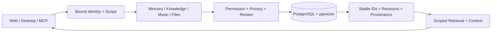

# ShirOS

**Personal Knowledge OS / Shared Memory Core** — 以 PostgreSQL 为权威存储、面向多 AI 客户端的个人知识基础设施。

当前源码版本：**0.7.18**。Python ≥ 3.12 · FastAPI · SQLAlchemy Core · PostgreSQL 16 · pgvector · MCP。

记忆、证据、音乐档案与修订由系统持有；模型通过受权限约束的接口读取和提交候选。客户端、模型和界面可以替换，稳定对象 ID、来源与历史持续保留。

## 当前能力

| 子系统 | 实现与边界 |
| --- | --- |
| Shared Memory | 来源、不可变修订、标签、撤销、幂等回执与有序事件；精确、关键词、向量和混合检索 |
| Knowledge | L2 权威对象引用、L1 领域综述、L0 全局核心；租约、依赖指纹、过期检测、候选审核与显式发布 |
| Music | Work / Recording / Release / Track 独立身份；人物、组合、组织、关系、分类、评价历史与图片 |
| Files & Conversations | 原件文件库、官方 JSON/ZIP 导入、按会话授权的增量采集；附件与正文独立授权 |
| Workbench | 本机网页工作台、中英文界面、受保护图片读取、嵌套音乐浏览 |
| MCP | 22 个工具；stdio 与受认证的本机 Streamable HTTP，服务端绑定身份和 scope |
| Windows Desktop | pywebview / PyInstaller / Inno Setup；full/core 功能模式与独立数据目录 |

0.7.18 使用带独立封面的嵌套作品集。完整覆盖作品的录音才关联该作品；Work → Recording → Release 保留临时曲目范围并提供“显示全部”。该范围只影响浏览，不裁剪权威详情和导出。录音的作品入口支持专辑作品与实际演奏歌曲。见 [音乐模型](docs/music-library.md) 与 [现行规则](docs/music-entry-rules.md)。

默认 provider 仍有明确标注的 Mock 摘要与 embedding；生产级多用户认证、物理擦除和全部专业领域尚未交付。Gemini 桥接准备与官方 Gemini 桌面应用实际支持是不同状态，见 [接入边界](docs/gemini-desktop-mcp.md)。

## 架构

模块化单体，共享 PostgreSQL 事务与权限，按服务划分领域责任。客户端经 Gateway 调用服务，不能操作 SQL 仓储、审批权威或任意本机文件。



| 层级 | 权威内容 | 发布规则 |
| --- | --- | --- |
| Evidence Store | Source、文件、附件与来源记录 | 授权保存，保留证据身份 |
| L2 | 详细记忆、音乐等领域对象 | 按领域服务治理，跨库引用 |
| L1 | 带依赖的领域综述修订 | 提交候选，本机审核发布 |
| L0 | 全局核心修订 | 独立确认与管理员发布 |

旧 Summary / Snapshot 保留为兼容实现，不直接代表新 L1/L0。事务、修订和可见性契约见 [架构说明](docs/architecture.md)。

## 从源码运行

需要 Git、[uv](https://docs.astral.sh/uv/)、Python 3.12+，以及 PostgreSQL 16 + pgvector。下面使用 Docker Compose；Windows 便携数据库见 [开发说明](docs/development.md)。

```powershell
git clone https://github.com/ShirrHaShirim/ShirOS.git
cd ShirOS
uv sync --locked --python 3.12
Copy-Item .env.example .env
```

在 `.env` 中为 `POSTGRES_PASSWORD` 和 `SHIROS_DB_PASSWORD` 填入相同的本地密码，然后执行：

```powershell
docker compose up -d --wait
uv run shiros migrate
uv run shiros db-health
uv run shiros web --port 8001
```

在第二个项目终端执行 `uv run shiros open`，通过受保护会话打开工作台。裸地址访问不自动授权。数据库默认绑定 `127.0.0.1:55432`，工作台绑定 loopback。`.env`、`.local/` 不进入版本库。

`uv run shiros dev --port 8000` 是独立开发健康 API：`/health/live` 检查进程，`/health/ready` 检查 PostgreSQL、pgvector、迁移与采集结构，失败返回 503。业务工作台具有自己的服务接口。

Windows 已准备便携运行时后，可用 `Start-ShirOS.cmd` 打开工作台。`ShirOS.cmd` 管理可选的常驻运行与已配置隧道；它不是新克隆环境的默认部署前提。

## MCP 接入

数据库迁移后创建独立只读身份：

```powershell
uv run python scripts/mcp_shiros_client.py init --client codex
```

支持本地 MCP 的客户端可使用以下配置，将路径替换为实际克隆目录：

```json
{
  "mcpServers": {
    "shiros": {
      "command": "<repo>/.venv/Scripts/python.exe",
      "args": ["<repo>/scripts/mcp_shiros_client.py", "serve", "--client", "codex"]
    }
  }
}
```

非 Windows 环境使用 `.venv/bin/python`。Profile 在本机保存 actor、scope 与私密凭据，配置示例不包含 token。工具可见不等于获准执行写入；记忆角色与音乐写入能力由所有者分别授权。见 [客户端说明](docs/shared-memory-clients.md) 和 [MCP 契约](src/shiros/adapters/mcp/README.md)。

## 开发与验证

```powershell
uv run shiros test                 # 无数据库单元测试
uv run shiros lint                 # Ruff
uv run mypy --platform win32       # 严格类型检查，包含 Windows 分支
uv run shiros integration          # 需要 SHIROS_TEST_DATABASE_URL
```

集成测试使用名称以 `_test` 结尾的专用数据库，连接信息通过进程环境注入。Windows 便携环境可用 `uv run python scripts/local_db.py test`。备份工具、浏览器回归与当前类型检查债务见 [开发说明](docs/development.md) 和 [验证记录](docs/source-publication-20261014.md)。

迁移 head：`0031_music_catalog_sort`。升级前备份，保留完整 Alembic 迁移链。源码仓库更新不会迁移或删除本机个人数据库。

## 目录与文档

```text
src/shiros/
  core/                  类型契约、权限、隐私、事件与来源
  adapters/database/     SQL 仓储、事务与就绪检查
  adapters/mcp/          工具与认证传输
  apps/web/              原生 HTML / CSS / JavaScript 工作台
  domains/               音乐领域模型与服务
  memory_*.py            网关、记忆服务、元数据与修订
  knowledge.py           L1/L0 治理、任务与依赖
  capture*.py            授权采集与增量会话
  file_library.py        原件文件服务
migrations/              完整顺序迁移
desktop/                 桌面入口、安装器与浏览器扩展源码
plugins/                 授权采集插件源码
scripts/                 部署、构建、测试与审核维护工具
tests/                   单元和独立数据库集成测试
docs/                    当前技术规范与历史决策
```

- [架构](docs/architecture.md) · [模块边界](docs/module-boundaries.md)
- [开发说明](docs/development.md) · [知识分层](docs/knowledge-v060.md)
- [音乐库](docs/music-library.md) · [采集协议](docs/conversation-sync-v073.md)
- [使用说明](docs/user-manual.md)
- [安全边界](SECURITY.md) · [贡献说明](CONTRIBUTING.md) · [版本摘要](CHANGELOG.md)

仓库发布源码、测试、迁移和技术文档。个人记忆、曲库数据库、私密配置、会话凭据、备份及构建包不属于源码快照；部分维护脚本需要所有者在本机提供经过审核的数据计划。

## 共建者

**ShirrHaShirim** — 项目所有者与维护者，负责方向、领域规则、设计和最终决策。

**OpenAI Codex** — AI 共建者，参与代码实现、问题修复、技术文档和测试验证。维护权、发布决策与数据所有权归项目所有者。
