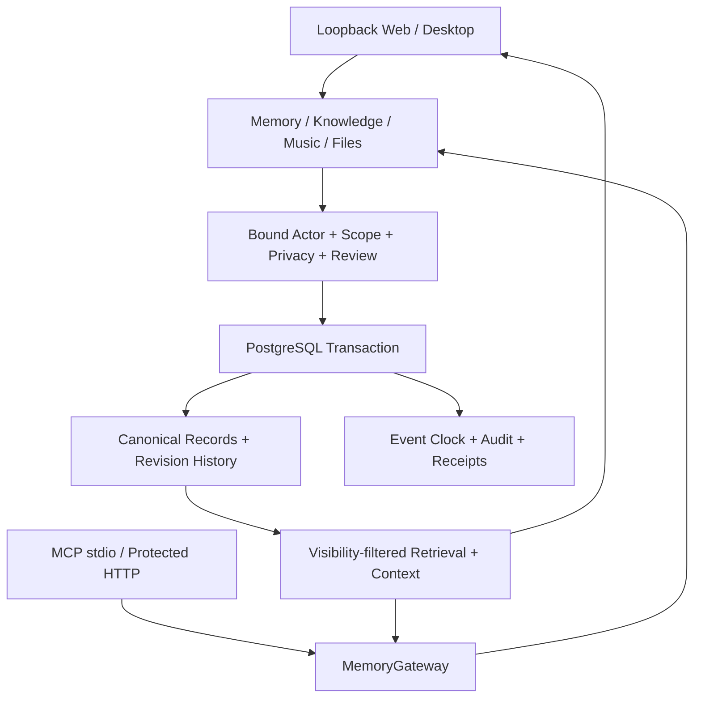

# ShirOS Architecture — 0.7.18

本文件描述当前实现；长期方向见 [Project Charter](../PROJECT_CHARTER.md)，历史决策见 [ADR](adr/002-modular-monolith.md)。

## 服务与信任边界

Python 模块化单体：Web、桌面和 MCP 复用服务，PostgreSQL 持有持久权威状态，前端缓存只支持瞬时浏览。

客户端不能选择其他 actor/scope、签发审批、操作 SQL 仓储或读取任意文件。角色和 capability 在服务端绑定。检索正文是参考数据，不产生执行权限。

`apps/api.py` 是独立健康 API；业务接口由 `apps/workbench.py` 承载。不能将健康 API 的限制写成整个系统只有健康端点。

## 事务与修订

SQLAlchemy Core 使用参数化 SQL；Alembic 保留至 `0031_music_catalog_sort` 的完整迁移链。对象采用 UUID，时间采用 UTC。核心实体和关系使用专用关系表，JSONB 用于有明确契约的元数据与任务草稿。

Memory 的稳定 ID 与不可变 revision ID 分开，新修订连接旧版本，数据库约束和触发器限制历史改写。预期 revision 检查防止静默覆盖。批准代表持久化许可，不提高真实性或证据等级。

核心写入使用事务级 advisory lock 和事务内 event clock；Source、Memory、embedding、事件和幂等回执同事务提交，避免序号与提交顺序错位。领域服务按自身契约保存审计，不将所有跨域动作描述为单个无限大的事务。

相同 request UUID 与内容指纹支持安全重试，同键异内容被拒绝。数据库外的文件与图片由专门服务管理；备份必须同时考虑数据库与二进制存储，恢复到独立目标验证。

## 隐私、来源与可见性

Source、Artifact、结构化引用与原件保留证据身份。权限和隐私在内容落库前检查；受限内容拒绝，敏感或不确定候选待审，普通候选可能由服务端政策批准。

正常查询、导出和派生读取统一受 scope 与可见性约束。隐藏可以恢复，恢复显示不能撤销来源撤销。审计历史保留，软删除不等于物理擦除。安全异常不能回显凭据或被拒绝的正文。

## 知识分层

| 层 | 权威与规则 |
| --- | --- |
| Evidence Store | Source、File Library；与综合层独立 |
| L2 | Memory、Music 等权威所有者；稳定 ID、修订和来源 |
| L1 | 领域综述版本、依赖指纹、本机审核 |
| L0 | 全局核心版本、额外确认和管理员发布 |

`knowledge_heads / knowledge_versions / knowledge_jobs / knowledge_audit` 承载新 L1/L0，旧 Summary/Snapshot 保留为兼容路径。任务保存租约、进度、基础修订和证据依赖。草稿与发布分开；依赖改变后综述过期，正文不进入新上下文，发布前再次验证。普通 L2 写入或 L1 发布不会自动修改 L0。见 [知识契约](knowledge-v060.md)。

## 音乐领域

Work 是创作，Recording 是演绎录音，Release 是具体发行，Track 是发行内位置。人物、组合、组织、关系、Genre、私人标签、评价和图片有独立契约；曲库不自动复制成普通记忆。

作品通过显式 `parent_work` 嵌套，区分创作 collection 与浏览 folder。各层使用自己的图片；父封面不能自动覆盖子作品。录音可包含可复用的显式子录音，不按音轨机械生成作品或录音。Genre 与作品集不是同一树。

完整覆盖作品才关联对应录音。Work → Recording → Release 的范围是临时导航状态，服务验证 scope 与对象并返回实际有序 track ID。“显示全部”释放当前范围，Back 恢复先前范围；独立搜索、排序、筛选及修改清除继承范围。权威详情和导出保留完整曲目。

图像经标准服务验证，保存字节、来源和按 image ID 绑定的显示裁剪。范围 UI 是紧凑提示行。图片维护计划与个人对象清单不随程序源码发布。

## 采集、文件与传输

采集按具体会话配对授权，每次写入重新校验，正文与附件独立授权。稳定消息 ID 支持增量合并；未取得原件时保留引用，不虚构已保存。文件导入复用服务边界，不能通过采集器默认扫描全部个人历史。

Web 绑定 loopback，使用当前用户受保护的进程会话，结合 Host、Origin、Fetch Metadata、自定义请求头、CSP 与 no-store。MCP 支持 stdio 和带 bearer token 的本机 HTTP，并验证 loopback peer 与匹配 Host/Origin。外部通道须独立配置和验收；本机端口不是公网认证方案。

Windows 桌面用 pywebview 承载工作台，PyInstaller/Inno Setup 从明确程序清单构建。full/core 是功能模式，常规安装创建空白数据，音乐测试快照是单独的显式构建输入。

## 当前限制

- 默认 provider 中仍有 Mock 摘要与 32 维 hash embedding。
- 本机能力凭据不是生产多用户认证。
- 迁移/应用数据库角色完全分离、完整敏感检测及物理擦除尚未交付。
- 论文、项目等专业领域未全部实现。
- 严格类型检查有已记录债务；测试通过与类型检查通过须分别报告。
